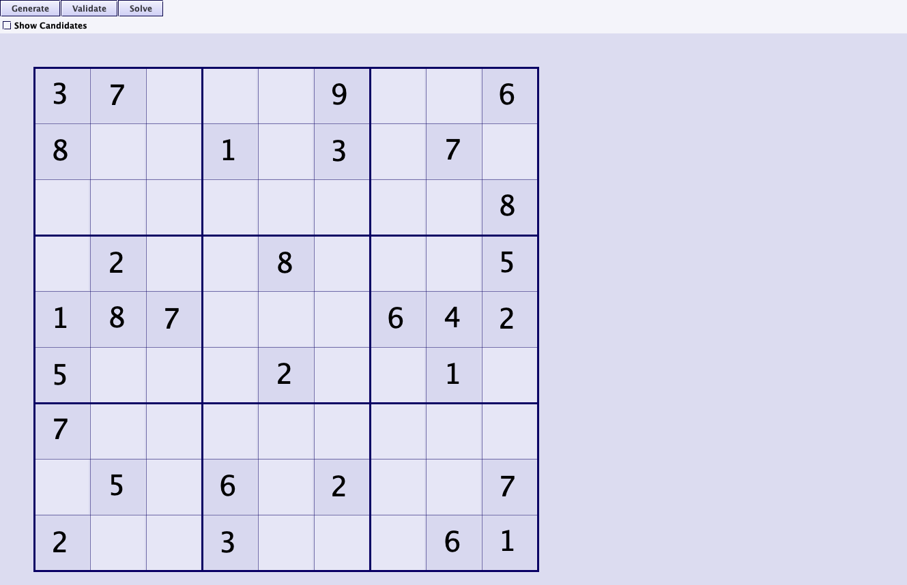
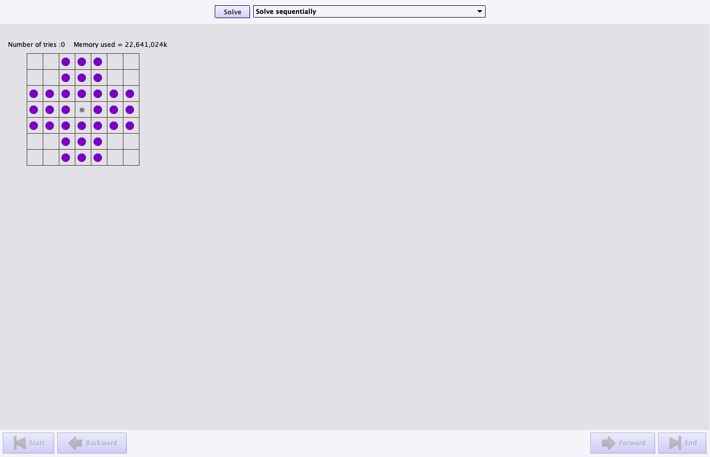
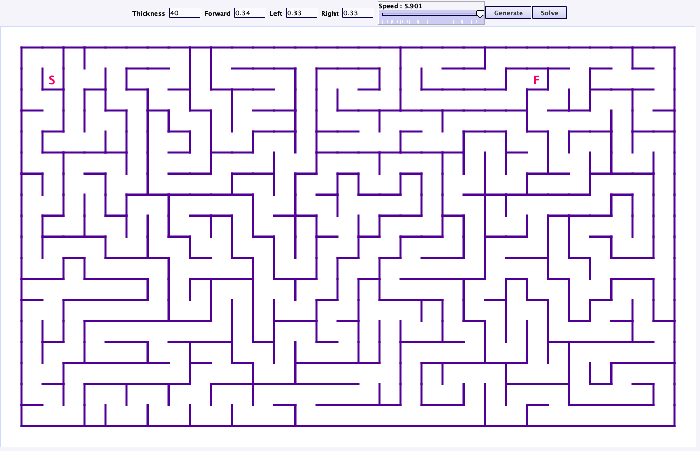
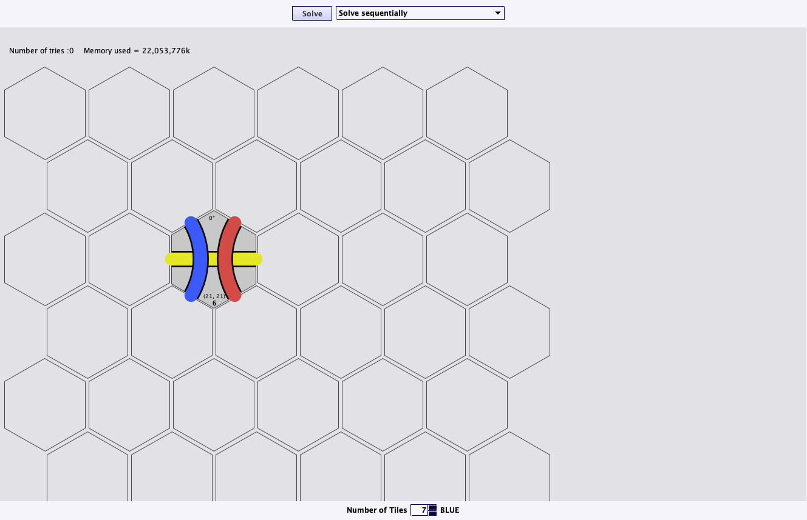

# bb4-puzzles

[](https://github.com/bb4/bb4-puzzles/actions/workflows/ci.yml)

📊 [Build status for all bb4 projects](https://github.com/bb4/.github)

A Scala puzzle framework with generators and solvers for classic puzzles — Sudoku, Hi-Q (peg solitaire), sliding tiles, Rubik’s Cube, Tantrix, mazes, and more. Each app shares a common search/UI framework so you can watch solvers find solutions or play by hand.

## Screenshots









## Puzzles

| Puzzle | Gradle task | Description |
|--------|-------------|-------------|
| [Hi-Q](docs/screenshots/hiq.png) | `runHiq` | Peg solitaire: jump until one peg remains in the center. |
| Sliding Puzzle | `runSlidingpuzzle` | Slide numbered tiles into order. |
| Rubix Cube | `runRubixcube` | Rotate cube layers until each face is a solid color (3D via jMonkeyEngine). |
| [Sudoku](docs/screenshots/sudoku.png) | `runSudoku` | Generate and solve Sudoku boards. |
| [Tantrix](docs/screenshots/tantrix.png) | `runTantrix` | Place hexagonal tiles so colored paths connect (3–30 pieces). |
| [Amazing Maze](docs/screenshots/maze.png) | `runMaze` | Generate mazes with tunable parameters. |
| One Tough Puzzle | `runRedpuzzle` | Nine-piece all-nub jigsaw; brute-force and genetic solvers. |
| Bridge Crossing | `runBridge` | Bridge-and-torch brain teaser: minimize crossing time. |
| Two Pails | `runTwopails` | Measure a target volume by pouring between two containers. |

## Running it

**Option 1 — installer (recommended):** download the installer for your OS from the
[latest release](https://github.com/bb4/bb4-puzzles/releases/latest)
(macOS `.dmg`, Windows `.msi`, Linux `.deb` — one installer per puzzle).

### macOS installers (Gatekeeper)

Release `.dmg` files are built with [jpackage](https://docs.oracle.com/en/java/javase/21/docs/specs/man/jpackage.html)
and are **not** signed with an Apple Developer ID or notarized (we do not use Apple’s paid developer
program). macOS tags apps you install from the internet with a **quarantine** flag and may refuse to
run them, showing *“could not verify … is free of malware”* with only **Move to Trash** — not because
the build is infected, but because Gatekeeper does not recognize the developer.

That extra step is unfortunate friction for users; the tradeoff is shipping free, unsigned open-source
installers. The app is open source here, or you can build the same `.dmg` yourself with
`./gradlew jpackage<Puzzle>`.

**After installing from the `.dmg` (required on most current Macs):**

1. Drag the app into **Applications** as usual. Note the exact name (e.g. `Hi-Q.app`, `Sudoku.app`).

2. In **Terminal**, remove the quarantine attribute **once per app** (only if you trust this GitHub
   release):

   ```bash
   xattr -dr com.apple.quarantine "/Applications/Hi-Q.app"
   ```

   Replace `Hi-Q` with your puzzle’s app name. Then open it normally (Finder, Launchpad, or Spotlight).

   Without this step, **Control‑click → Open** in Finder and Apple’s **Open Anyway** in System
   Settings often **do not** help on recent macOS; quarantine removal is what usually works.

**If it still will not launch:** open the app once, then **System Settings → Privacy & Security →
Security → Open Anyway** for that app.

**Avoid the `.app` entirely:** use **Option 2** below (`./gradlew runHiq`, etc.) with JDK 25+, or
`./gradlew installDist` and run scripts under `build/install/bb4-puzzles/bin/` — no quarantine step.

**Option 2 — from source:**

```bash
git clone https://github.com/bb4/bb4-puzzles.git
cd bb4-puzzles
./gradlew runSudoku          # or runHiq, runMaze, runTantrix, …
./gradlew tasks --group application   # list all runnable puzzles
```

The default `./gradlew run` launches the maze generator. Gradle creates a `run<Puzzle>` task for each entry in `appMap`.

## Using it as a library

Published artifacts (latest release **2.1**):

```groovy
implementation 'com.barrybecker4:bb4-puzzle:2.1'          // shared framework
implementation 'com.barrybecker4:bb4-sudoku:2.1'
implementation 'com.barrybecker4:bb4-hiq:2.1'
// also: bb4-slidingpuzzle, bb4-rubixcube, bb4-tantrix, bb4-maze,
//       bb4-redpuzzle, bb4-bridge, bb4-twopails
```

See the [releases page](https://github.com/bb4/bb4-puzzles/releases) if you need a different version.

## What's inside

- **`com.barrybecker4.puzzle.common`** — shared framework: puzzle controllers, Swing viewers/renderers, and solvers (sequential, concurrent, A*, IDA*)
- **Per-puzzle packages** under `com.barrybecker4.puzzle.*` — model, UI, and solver code for each app in the table above
- **`com.barrybecker4.puzzle.rubixcube`** — 3D cube UI built on jMonkeyEngine / LWJGL

## Benchmarks

The Tantrix and Red Puzzle solvers that use [bb4-optimization](https://github.com/bb4/bb4-optimization)
(genetic search, simulated annealing, global hill climbing, ...) can be benchmarked, and the timings
are compared across bb4-optimization versions in [docs/benchmarks.md](docs/benchmarks.md).

Each solve runs in its own JVM that is killed if it exceeds the time limit, so a stuck solver cannot
skew later timings (`--in-process` turns that off and is only for quick experiments). Results are
merged into `docs/benchmarks.json` under the bb4-optimization version on the classpath; regenerating
the markdown table without re-running solvers is `./gradlew benchmarkReport`. Pass
`-PbenchmarkArgs="..."` to override any task’s defaults (see options below).

### Standard run (default)

Runs Tantrix at 3, 6, and 9 tiles, Red Puzzle, and Sliding Puzzle 3×3 and 4×4 — three repetitions per
cell, 30s limit per run. Usually on the order of tens of minutes, not hours.

```bash
./gradlew benchmark
```

### Full matrix (long run)

All Tantrix sizes through 24 tiles, five repetitions, 60s limit — roughly **139** algorithm×variant
cells, with many minutes spent on timeouts and JVM startup. Use when you want numbers comparable to
historical full runs in [docs/benchmarks.md](docs/benchmarks.md).

```bash
./gradlew benchmarkFull
```

### Quick smoke test

Sanity-check that benchmarks run; skips regenerating the markdown report.

```bash
./gradlew benchmark -PbenchmarkArgs="--reps=1 --timeout=15 --tantrix-sizes=3,6,9 --puzzles=tantrix --no-report"
```

### Red Puzzle only

```bash
./gradlew benchmark -PbenchmarkArgs="--puzzles=redpuzzle --reps=1 --timeout=10"
```

### Classpath check and other options

```bash
./gradlew benchmark -PbenchmarkArgs="--lib-version=2.0.0"
```

`--lib-version` makes the run fail if a different bb4-optimization (or composite build) is actually on
the classpath. Algorithms are discovered from each puzzle’s `Algorithm` enum, so new strategies appear
automatically (older versions show `n/a` in the report). Further flags: `--timeout`, `--reps`,
`--tantrix-sizes`, `--sliding-sizes`, `--puzzles`, `--results`, `--report`, `--no-report`, `--in-process`.
Timings are only comparable between runs on the same machine.

## Building from source

Requires **JDK 25+** (bb4-gradle 2.1). See the [Building bb4 Projects wiki](https://github.com/bb4/bb4-common/wiki/Building-bb4-Projects).

## License

MIT — see [LICENSE](LICENSE).
